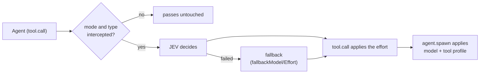

# JEV Orchestrator

🌐 English · [Português (Brasil)](README.pt-BR.md)

A Claude Code 2.1.294 MOD (plugin) that routes every `Agent` spawn through JEV (TypeSafe). JEV
decides the model (haiku, sonnet, opus), the effort, and the tool profile of each subagent.

## Flow



- `tool.call` (Agent) queries JEV and applies the effort.
- `agent.spawn`, correlated by `tool_use_id`, applies the model and the tool profile.
- Fail-open: the MOD never denies a spawn. If JEV fails (missing key, timeout, network, `http_*`),
  the spawn proceeds with `fallbackModel`/`fallbackEffort`/`fallbackAgent` and the reason goes to the log.

## Installation

Marketplace only. In a Claude Code session:

```
/plugin marketplace add hiyoku/jev-orc
/plugin install jev-orchestrator@jev-orchestrator
```

The second command opens the plugin details; choose the scope (user, project, or local).

## JEV key

Claude Code offers the plugin options dialog when the plugin is first enabled: fill in
**TypeSafe / JEV API key** (`typesafeApiKey`). To set or change it later, open `/plugin` →
**Installed** → `jev-orchestrator` → **Configure options**.

The field is `sensitive`: the key is kept in the system secure storage (Keychain on macOS), not in
`settings.json`, and does not appear in `/config`. With the field empty, the `TYPESAFE_API_KEY`
(or `JEV_API_KEY`) environment variable of whoever runs `claude` applies. The key never reaches the
log, the status line, toasts, or error messages. With no key at all, every routed spawn falls back
(with a toast).

## Modes

| `mode` | Behavior |
|---|---|
| `auto` (default) | JEV decides every spawn of the types in `agentsIntercept` |
| `off` | disabled; the status line shows `jev OFF` |
| `explicit` | only routes spawns whose `description` starts with `[jev]` (the marker is removed) |

Toggle with the `/jev-orc` command:

| Command | Effect |
|---|---|
| `/jev-orc` | toggles `auto` ⇄ `off` (from `explicit` it goes to `off`) |
| `/jev-orc on` / `off` / `explicit` | writes `auto` / `off` / `explicit` |
| `/jev-orc status` | shows the mode and the status line, without writing |

To pick `model`/`effort` by hand, turn it off with `/jev-orc off`; it applies from the next spawn.

Or: `/config`, row `jev-orchestrator.mode`; or in settings:

```json
{ "pluginConfigs": { "jev-orchestrator": { "options": { "mode": "off" } } } }
```

All fields are in [docs/configuration.md](docs/configuration.md).

**Note:** on a routed spawn, the MOD overrides the `model` and `effort` passed by hand. To choose
manually, turn it off (`mode=off`) or use `explicit` and call without the `[jev]` marker.
You can also pin values with `forceModel`/`forceEffort`.

## Status line

```text
jev ON · haiku·low·t-read · 42k tok $0.08 · vs opus/high ~$0.31 (-74%)
jev OFF
```

- `haiku·low·t-read`: last routing (model, effort, profile); on failure, `fallback (<reason>)`.
- `42k tok $0.08`: tokens and actual cost of the routed agents in the session (plus `jevPricePerCall`
  per JEV call).
- `vs opus/high`: the user's model and effort. The effort stays `?` until the MOD sees a main-loop turn.
- `~$0.31 (-74%)`: **estimate**. The counterfactual is the same tokens on the user's model; it does
  not model how much the effort changes the token count. `+x%` means the routed run cost more.
  An estimate below US$ 0.0005 shows as `<$0.001`.
- `logLevel` does not affect the status line.

Prices come from `priceHaiku/Sonnet/Opus` (US$/MTok).

Plugin messages (toasts, `/jev-orc` replies, and status line words) follow the Claude Code language and fall back to English; the `language` option (`auto`, `en`, `pt-BR`) forces a language.

## Decision log

`~/.claude/jev-orchestrator/decisions.jsonl`, one JSON line per decision. Fields:

| Field | Content |
|---|---|
| `ts` | ISO 8601 |
| `tool_use_id` | id of the Agent call |
| `description` | description, without the `[jev]` marker |
| `outcome` | `routed`, `fallback`, `skip`, or `verifier` |
| `models` | models (the second is the verifier, if any) |
| `effort`, `profile` | applied decision |
| `reasons` | why each choice was made |
| `jev` | raw JEV numbers (scores, `*_confidence`, `deliberation`) |
| `error` | `missing_key`, `timeout`, `network`, `bad_payload`, or `http_<status>` |
| `jev_request` | only with `logLevel=debug`: task truncated to 200 characters, and context |

Never written: the API key, the full prompt, messages, and tool results.
Rotation: past 1 MiB, the file becomes `decisions.1.jsonl` (one generation). `logLevel=off`
turns the log off.

```bash
tail -n 20 ~/.claude/jev-orchestrator/decisions.jsonl
tail -n 20 ~/.claude/jev-orchestrator/decisions.jsonl | jq -c 'del(.ts,.tool_use_id)'
```

The log lives outside the repo and is not versioned (`.gitignore`: `decisions*.jsonl`).

## Multi-model (optional)

Off by default (`multiModel=false`). When on, with `maxModelsPerTask >= 2`, a verifier reviews the
answer when the complexity is opus-level and JEV's confidence is below 0.5. The verifier runs in
the read-only profile `jev-orchestrator:t-read`. During validation, the 0.5 confidence cutoff was
almost never reached (confidence ≥ 0.69 even for vague requests), so the verifier did not fire.
Recalibration will be done with log data (user's decision).

## More

- [Configuration](docs/configuration.md)
- [Troubleshooting](docs/troubleshooting.md)
