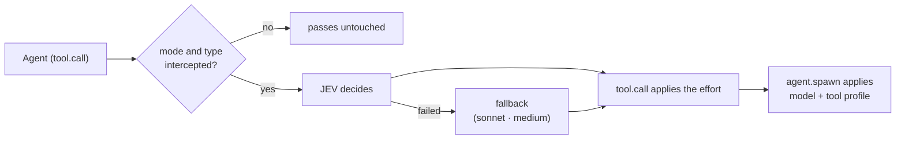

# JEV Orchestrator

English · [Português (Brasil)](README.pt-BR.md)

Hi! (^_^)/ This is a Claude Code MOD (plugin) that sends every `Agent` spawn through JEV (TypeSafe), so
JEV can pick the model (haiku, sonnet, opus), the effort, and the tool profile of each subagent for you.

## Installation

Getting started takes two commands. In a Claude Code session:

```
/plugin marketplace add hiyoku/jev-orc
/plugin install jev-orchestrator@jev-orc
```

The second command opens the plugin details, so just pick the scope you like (user, project, or local). Then add your JEV key (next section) and you're set! (^o^)b

## Usage

### How it works

You do not call JEV yourself. Once the plugin is on, every `Agent` spawn of the agents in scope (`agentScope`: Claude Code's own agents by default, or all of them) goes through JEV first, which reads the task text and picks the model, the effort and the tool profile for that subagent. If JEV is unavailable, the spawn still runs (sonnet · medium). The [Flow](#flow) section has the diagram, and `/jev-orc` turns it on or off.

The plugin also ships two skills that make the most of this: `plan` cuts a request into small tasks, and `run` spawns one subagent per task. Small, mechanical tasks are what JEV sends to the cheapest model (haiku), so the plan is where most of the savings come from.

### Plan

`/jev-orchestrator:plan <request>` turns a request into a folder `docs/dev/NNN_<ShortDescription>/` with:

- `prompt.md`: goal, context, constraints, done criteria, the task table, and the execution waves (which tasks can run in parallel);
- one file per task (`01_<name>.md`, `02_<name>.md`, ...), each cut small enough for a cheap model, with exact paths, code, and the verification command.

It only writes files; nothing is executed. `docs/dev/` is ignored by git, so the plan stays local.

**Tip: write the request with an AI.** The plan is only as good as its input. Before calling `/jev-orchestrator:plan`, ask any AI assistant (Claude, ChatGPT, ...) to turn your idea into a complete request: goal, which files or areas are involved, what must not change, and how to check that it is done. Paste that text as the argument:

```
/jev-orchestrator:plan Add a --json flag to the export command. Files: src/cli/export.ts and its test. Keep the default output unchanged. Done when `npm test` passes and `export --json` prints valid JSON.
```

Read the generated `prompt.md` and the task files before running; editing them is cheap, fixing a wrong run is not.

### Run

`/jev-orchestrator:run <NNN>` executes the plan `docs/dev/NNN_*/` (with no number, the latest one):

1. It reads `prompt.md` and follows the Execution section, wave by wave.
2. Each task of a wave becomes one subagent, spawned in parallel and routed by JEV (no model or effort is set by hand).
3. Each agent gets its task file first, what the tasks it depends on delivered, and a short context.
4. If a task fails, the waves that depend on it stop and you are told; independent waves go on.
5. At the end you get a report per task (done, failed, or skipped), and the results are checked. Commits only happen when you ask.

```
/jev-orchestrator:run 001
```

## Flow



- `tool.call` (Agent) queries JEV and applies the effort.
- `agent.spawn`, correlated by `tool_use_id`, applies the model and the tool profile.
- Fail-open: the MOD never denies a spawn. If JEV fails (missing key, timeout, network, `http_*`),
  the spawn proceeds on sonnet · medium (capped by `maxModel`/`maxEffort`) and the reason goes to the log.

## JEV key

Claude Code offers the plugin options dialog when the plugin is first enabled: fill in
**JEV API key (TypeSafe or OpenRouter)** (`typesafeApiKey`). To set or change it later, open `/plugin` →
**Installed** → `jev-orchestrator` → **Configure options**.

The field is `sensitive`: the key is kept in the system secure storage (Keychain on macOS), not in
`settings.json`, and does not appear in `/config`. With the field empty, the `TYPESAFE_API_KEY`
(or `JEV_API_KEY`) environment variable of whoever runs `claude` applies. The key never reaches the
log, the status line, toasts, or error messages. With no key at all, every routed spawn falls back
(with a toast).

**Via OpenRouter:** OpenRouter hosts JEV with the same System One API. Put an OpenRouter key in
`typesafeApiKey` and set **JEV endpoint** (`jevEndpoint`) to `https://openrouter.ai/api/v1/systemone`.
The endpoint must be https, since the key goes with every call.

## Modes

| `mode` | Behavior |
|---|---|
| `auto` (default) | JEV decides every spawn of the agents in scope (`agentScope`) |
| `off` | disabled; the status line shows `jev OFF` |
| `explicit` | only routes spawns whose `description` starts with `[jev]` (the marker is removed) |

Toggle with the `/jev-orc` command:

| Command | Effect |
|---|---|
| `/jev-orc` | toggles `auto` ⇄ `off` (from `explicit` it goes to `off`) |
| `/jev-orc on` / `off` / `explicit` | writes `auto` / `off` / `explicit` |
| `/jev-orc status` | shows the mode and the status line, without writing |
| `/jev-orc history` | lists the savings of the last 10 sessions, newest first; the history is kept across sessions |

To pick `model`/`effort` by hand, turn it off with `/jev-orc off`; it applies from the next spawn.

Or: `/config`, row `jev-orchestrator.mode`; or in settings:

```json
{ "pluginConfigs": { "jev-orchestrator": { "options": { "mode": "off" } } } }
```

All fields are in [docs/configuration.md](docs/configuration.md).

**Note:** on a routed spawn, the MOD overrides the `model` and `effort` passed by hand. To choose
manually, turn it off (`mode=off`) or use `explicit` and call without the `[jev]` marker.
`maxModel`/`maxEffort` cap what JEV may pick. `maxEffort` also caps the effort of your own
prompts (the main agent) when `mode` is not `off`, even with `mainEffort` off.

## Status line

By default (`statusStyle: nerd`) each part gets a Nerd Font icon and the parts are split by `│`:
power, route, tokens, cost, comparison, total, and effort. It needs a Nerd Font in the terminal;
without one the icons show as squares. `statusStyle: plain` is plain text with no icons, and is what
the examples below show:

```text
jev ON · haiku·low·t-read · 42k tok $0.08 · vs opus/high ~$0.31 (-74%) — high
jev OFF — high
```

Right after start, before any subagent is routed, it is shorter (that is normal):

```text
jev ON · prompt·medium — medium
```

The rest appears as soon as the first subagent is routed. Not seeing it yet? Spawn an `Agent` and watch it grow (^_^)

- `haiku·low·t-read`: last routing (model, effort, profile); on failure, `fallback (<reason>)`.
- `42k tok $0.08`: tokens and actual cost of the routed agents in the session (in `nerd`, tokens and
  cost are two segments).
- `vs opus/high`: the compare model and the effort. By default (`compareModel: auto`) it is the user's
  model; the effort stays `?` until the MOD sees a main-loop turn. With a fixed `compareModel`
  (`haiku`, `sonnet`, `opus`, `fable`) the label shows only the name, e.g. `vs fable`. It changes only
  the status line's comparison price, not the routing.
- `~$0.31 (-74%)`: **estimate**. The counterfactual is the same tokens on the compare model (default: the user's model); it does
  not model how much the effort changes the token count. `+x%` means the routed run cost more.
  An estimate below US$ 0.0005 shows as `<$0.001`.
- `— high` (in `nerd`, the last segment): effort the main loop's last request ran with (after `mainEffort`, if on); subagents
  do not change it. Hidden until the MOD sees a main-loop turn.
- `logLevel` does not affect the status line.

Prices are the list prices in `src/config.ts` (US$/MTok), Fable included.

Plugin messages (toasts, `/jev-orc` replies, and status line words) follow the Claude Code language and fall back to English; the `language` option (`auto`, `en`, `pt-BR`) forces a language.

## Decision log

`~/.claude/jev-orchestrator/decisions.jsonl`, one JSON line per decision. Fields:

| Field | Content |
|---|---|
| `ts` | ISO 8601 |
| `tool_use_id` | id of the Agent call |
| `description` | description, without the `[jev]` marker |
| `outcome` | `routed`, `fallback`, `skip`, or `verifier` |
| `models` | models (the second is the verifier, if any) |
| `effort`, `profile` | applied decision |
| `reasons` | why each choice was made |
| `jev` | raw JEV numbers: each score, its `*_confidence` and the chance of each level (`*_p0`, `*_p1`, ...), and each yes/no answer |
| `jev_model`, `plugin_version` | the JEV version that answered (e.g. `jev-1.14.0`) and this plugin's version: a calibration keeps to one of each |
| `error` | `missing_key`, `timeout`, `network`, `bad_payload`, or `http_<status>` |
| `jev_request` | only with `logLevel=debug`: the fields sent to JEV, with the task and the agent's last reply cut to 200 characters |

Never written: the API key, the full prompt, messages, and tool results.
Rotation: past 1 MiB, the file becomes `decisions.1.jsonl` (one generation). `logLevel=off`
turns the log off.

```bash
tail -n 20 ~/.claude/jev-orchestrator/decisions.jsonl
tail -n 20 ~/.claude/jev-orchestrator/decisions.jsonl | jq -c 'del(.ts,.tool_use_id)'
```

The log lives outside the repo and is not versioned (`.gitignore`: `decisions*.jsonl`).

## Multi-model (optional)

Off by default (`multiModel=false`). When on, a verifier reviews the answer when JEV picked opus
because the open-design complexity level is likely (chance ≥ 0.4) but not settled (below 0.7).
The verifier runs in the read-only profile `jev-orchestrator:t-read`. The cutoffs are not
calibrated yet; recalibration will be done with log data (user's decision).

## Main prompt effort (optional)

Off by default (`mainEffort=false`). The routing above applies to subagents only; your own prompts
run on the session model with your effort. When on (and `mode=auto`), each typed prompt goes to
JEV first and its effort becomes the one JEV picked (deliberation), capped by `maxEffort`. JEV also reads the agent's last reply, so a short follow-up ("yes", "explain more") is judged by what it picks up. The model never changes: switching it mid-conversation would throw away the
prompt cache. It costs one JEV call, and up to 8 s of wait, before each prompt. The
status line shows `prompt·<effort>` and the log an entry with `"outcome":"main"`; without JEV the
prompt keeps your effort.

## Privacy

For each routed subagent spawn (and each prompt, with `mainEffort` on) the task text is sent to
the JEV endpoint (`jevEndpoint`: TypeSafe, or OpenRouter); past 4000 characters it keeps the start
and the end and drops the middle. The agent's name and a short description of it (your
`agentHints`, else the one Claude Code gives it, cut to 120 characters) go along with a subagent's
task. With `mainEffort` on, the agent's last reply goes along with your prompt, cut the same way
to 1500 characters. Nothing else leaves your machine. The key is kept in the system secure
storage. The local decision log holds these texts only with `logLevel=debug` (cut to 200
characters); `logLevel=off` writes nothing.

## Contributing

Any improvement is welcome: a bug fix, a clearer doc, a better question for JEV, a new idea. You do not need to ask first.

1. Open an [issue](https://github.com/hiyoku/jev-orc/issues) to discuss it, or go straight to a pull request.
2. Fork the repo, create a branch from `main`, and make your change. Small, focused PRs are easier to review.
3. Run `claude plugin test .` and `claude plugin validate .`; both should pass.
4. Open a pull request against `main` and say what changed and why. Commit messages follow the style of the history (`feat(scope): summary`).
5. A merged PR releases the version in `.claude-plugin/plugin.json`: bump `version` there if you want a new tag and GitHub release. Without a bump nothing is released.

## More

- [Configuration](docs/configuration.md)
- [Troubleshooting](docs/troubleshooting.md)
