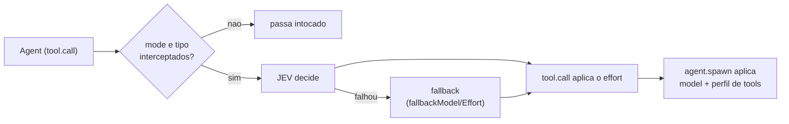

# JEV Orchestrator

MOD (plugin) do Claude Code 2.1.294 que roteia cada spawn de `Agent` pelo JEV (TypeSafe). O JEV
decide o modelo (haiku, sonnet, opus), o effort e o perfil de tools de cada subagente.

## Fluxo



- `tool.call` (Agent) consulta o JEV e aplica o effort.
- `agent.spawn`, correlacionado por `tool_use_id`, aplica o modelo e o perfil de tools.
- Fail-open: o MOD nunca nega um spawn. Se o JEV falha (chave ausente, timeout, rede, `http_*`), o
  spawn segue com `fallbackModel`/`fallbackEffort`/`fallbackAgent` e o motivo vai para o log.

## Instalação

```bash
claude --plugin-dir <repo>
# ou, via marketplace:
/plugin install jev-orchestrator --marketplace <owner>/jev-orc
```

## Variáveis de ambiente

Defina `TYPESAFE_API_KEY` (ou `JEV_API_KEY`) no ambiente de quem executa o `claude`. A chave nunca
vai para a config nem para o log. Sem chave, todo spawn roteado cai no fallback (com um toast).

## Modos

| `mode` | Comportamento |
|---|---|
| `auto` (padrão) | o JEV decide cada spawn dos tipos em `agentsIntercept` |
| `off` | desligado; a status line mostra `jev OFF` |
| `explicit` | só roteia spawns cuja `description` começa com `[jev]` (o marcador é removido) |

Ligar e desligar: `/config`, linha `jev-orchestrator.mode`; ou nas settings:

```json
{ "pluginConfigs": { "jev-orchestrator": { "options": { "mode": "off" } } } }
```

Todos os campos estão em [docs/configuration.md](docs/configuration.md).

**Atenção:** num spawn roteado, o MOD sobrescreve o `model` e o `effort` passados à mão. Para
escolher manualmente, desligue (`mode=off`) ou use `explicit` e chame sem o marcador `[jev]`.
Também é possível fixar valores com `forceModel`/`forceEffort`.

## Status line

```text
jev ON · haiku·low·t-read · 42k tok $0.08 · vs opus/high ~$0.31 (-74%)
jev OFF
```

- `haiku·low·t-read`: último roteamento (modelo, effort, perfil); em falha, `fallback (<motivo>)`.
- `42k tok $0.08`: tokens e custo real dos agents roteados na sessão (mais `jevPricePerCall` por
  chamada ao JEV).
- `vs opus/high`: modelo e effort do usuário. O effort fica `?` até o MOD ver um turno do loop principal.
- `~$0.31 (-74%)`: **estimativa**. O contrafactual são os mesmos tokens no modelo do usuário; não
  modela quanto o effort muda a contagem de tokens. `+x%` indica que o roteado saiu mais caro.
  Estimativa abaixo de US$ 0,0005 aparece como `<$0.001`.
- `logLevel` não afeta a status line.

Os preços vêm de `priceHaiku/Sonnet/Opus` (US$/MTok).

## Log de decisões

`~/.claude/jev-orchestrator/decisions.jsonl`, uma linha JSON por decisão. Campos:

| Campo | Conteúdo |
|---|---|
| `ts` | ISO 8601 |
| `tool_use_id` | id da chamada de Agent |
| `description` | descrição, sem o marcador `[jev]` |
| `outcome` | `routed`, `fallback`, `skip` ou `verifier` |
| `models` | modelos (o segundo é o verificador, se houver) |
| `effort`, `profile` | decisão aplicada |
| `reasons` | por que cada escolha foi feita |
| `jev` | números crus do JEV (scores, `*_confidence`, `deliberation`) |
| `error` | `missing_key`, `timeout`, `network`, `bad_payload` ou `http_<status>` |
| `jev_request` | só com `logLevel=debug`: tarefa truncada em 200 caracteres e contexto |

Nunca é gravado: a chave de API, o prompt completo, mensagens e resultados de tools.
Rotação: ao passar de 1 MiB, o arquivo vira `decisions.1.jsonl` (uma geração). `logLevel=off`
desliga o log.

```bash
tail -n 20 ~/.claude/jev-orchestrator/decisions.jsonl
tail -n 20 ~/.claude/jev-orchestrator/decisions.jsonl | jq -c 'del(.ts,.tool_use_id)'
```

O log fica fora do repo e não é versionado (`.gitignore`: `decisions*.jsonl`).

## Multi-modelo (opcional)

Desligado por padrão (`multiModel=false`). Ligado, com `maxModelsPerTask >= 2`, um verificador
revisa a resposta quando a complexidade é de nível opus e a confiança do JEV está abaixo de 0.5.
O verificador roda no perfil só de leitura `jev-orchestrator:t-read`. Na validação, o corte de
confiança 0.5 quase nunca foi atingido (confiança ≥ 0.69 mesmo para pedidos vagos), então o
verificador não disparou. A recalibração será feita com dados do log (decisão do usuário).

## Skill `/jev-dispatcher`

Camada de compatibilidade que mantém o nome exato `/jev-dispatcher`. Instalação por symlink e como
reverter: [compat/README.md](compat/README.md).

## Mais

- [Configuração](docs/configuration.md)
- [Limites conhecidos](docs/known-limits.md)
- [Troubleshooting](docs/troubleshooting.md)
