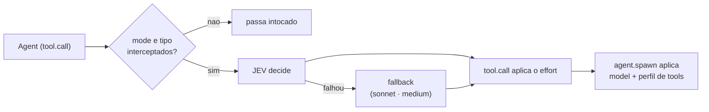

# JEV Orchestrator

[English](README.md) · Português (Brasil)

Oi! (^_^)/ Este é um MOD (plugin) do Claude Code que passa cada spawn de `Agent` pelo JEV (TypeSafe),
para o JEV escolher por você o modelo (haiku, sonnet, opus), o effort e o perfil de tools de cada subagente.

## Instalação

Começar leva só dois comandos. Numa sessão do Claude Code:

```
/plugin marketplace add hiyoku/jev-orc
/plugin install jev-orchestrator@jev-orc
```

O segundo comando abre os detalhes do plugin, é só escolher o escopo que preferir (usuário, projeto ou local). Depois configure sua chave do JEV (próxima seção) e pronto! (^o^)b

## Fluxo



- `tool.call` (Agent) consulta o JEV e aplica o effort.
- `agent.spawn`, correlacionado por `tool_use_id`, aplica o modelo e o perfil de tools.
- Fail-open: o MOD nunca nega um spawn. Se o JEV falha (chave ausente, timeout, rede, `http_*`), o
  spawn segue em sonnet · medium (limitado por `maxModel`/`maxEffort`) e o motivo vai para o log.

## Chave do JEV

O Claude Code oferece o diálogo de opções do plugin quando ele é habilitado pela primeira vez:
preencha **JEV API key (TypeSafe or OpenRouter)** (`typesafeApiKey`). Para definir ou trocar depois, abra
`/plugin` → **Installed** → `jev-orchestrator` → **Configure options**.

O campo é `sensitive`: a chave fica no armazenamento seguro do sistema (Keychain no macOS), não no
`settings.json`, e não aparece no `/config`. Com o campo vazio, vale a variável de ambiente
`TYPESAFE_API_KEY` (ou `JEV_API_KEY`) de quem executa o `claude`. A chave nunca vai para o log, a
status line, os toasts ou as mensagens de erro. Sem chave nenhuma, todo spawn roteado cai no
fallback (com um toast).

**Pelo OpenRouter:** o OpenRouter hospeda o JEV com a mesma API System One. Coloque uma chave do
OpenRouter em `typesafeApiKey` e defina **JEV endpoint** (`jevEndpoint`) como
`https://openrouter.ai/api/v1/systemone`. O endpoint precisa ser https, porque a chave vai junto em
toda chamada.

## Modos

| `mode` | Comportamento |
|---|---|
| `auto` (padrão) | o JEV decide cada spawn `general-purpose` e `Explore` |
| `off` | desligado; a status line mostra `jev OFF` |
| `explicit` | só roteia spawns cuja `description` começa com `[jev]` (o marcador é removido) |

Ligar e desligar pelo comando `/jev-orc`:

| Comando | Efeito |
|---|---|
| `/jev-orc` | alterna `auto` ⇄ `off` (de `explicit` vai para `off`) |
| `/jev-orc on` / `off` / `explicit` | grava `auto` / `off` / `explicit` |
| `/jev-orc status` | mostra o modo e a status line, sem gravar |

Para escolher `model`/`effort` à mão, desligue com `/jev-orc off`; vale a partir do próximo spawn.

Ou: `/config`, linha `jev-orchestrator.mode`; ou nas settings:

```json
{ "pluginConfigs": { "jev-orchestrator": { "options": { "mode": "off" } } } }
```

Todos os campos estão em [docs/configuration.pt-BR.md](docs/configuration.pt-BR.md).

**Atenção:** num spawn roteado, o MOD sobrescreve o `model` e o `effort` passados à mão. Para
escolher manualmente, desligue (`mode=off`) ou use `explicit` e chame sem o marcador `[jev]`.
`maxModel`/`maxEffort` limitam o que o JEV pode escolher. O `maxEffort` também limita o effort dos
seus próprios prompts (o agente principal) quando `mode` não é `off`, mesmo com `mainEffort` desligado.

## Status line

Por padrão (`statusStyle: nerd`) cada parte ganha um ícone Nerd Font e as partes são separadas por
`│`: ligado, rota, tokens, custo, comparação, total e effort. Exige uma Nerd Font no terminal; sem ela
os ícones aparecem como quadrados. `statusStyle: plain` é texto puro, sem ícones, e é o que os
exemplos abaixo mostram:

```text
jev ON · haiku·low·t-read · 42k tok $0.08 · vs opus/high ~$0.31 (-74%) — high
jev OFF — high
```

Logo ao iniciar, antes de qualquer subagente ser roteado, ela é mais curta (é normal):

```text
jev ON · prompt·medium — medium
```

O resto aparece assim que o primeiro subagente for roteado. Ainda não apareceu? Dispare um `Agent` e veja crescer (^_^)

- `haiku·low·t-read`: último roteamento (modelo, effort, perfil); em falha, `fallback (<motivo>)`.
- `42k tok $0.08`: tokens e custo real dos agents roteados na sessão (no `nerd`, tokens e custo são
  dois segmentos).
- `vs opus/high`: o modelo de comparação e o effort. Por padrão (`compareModel: auto`) é o modelo do
  usuário; o effort fica `?` até o MOD ver um turno do loop principal. Com um `compareModel` fixo
  (`haiku`, `sonnet`, `opus`, `fable`) o rótulo mostra só o nome, ex. `vs fable`. Muda só o preço de
  comparação da status line, não o roteamento.
- `~$0.31 (-74%)`: **estimativa**. O contrafactual são os mesmos tokens no modelo de comparação (padrão: o modelo do usuário); não
  modela quanto o effort muda a contagem de tokens. `+x%` indica que o roteado saiu mais caro.
  Estimativa abaixo de US$ 0,0005 aparece como `<$0.001`.
- `— high` (no `nerd`, o último segmento): effort com que rodou a última requisição do loop principal (após o `mainEffort`, se
  ligado); subagentes não o alteram. Oculto até o MOD ver um turno do loop principal.
- `logLevel` não afeta a status line.

Os preços são os de tabela em `src/config.ts` (US$/MTok), incluindo o Fable.

As mensagens do plugin (toasts, respostas do `/jev-orc` e palavras da status line) seguem o idioma do Claude Code e caem para o inglês; a opção `language` (`auto`, `en`, `pt-BR`) força um idioma.

## Log de decisões

`~/.claude/jev-orchestrator/decisions.jsonl`, uma linha JSON por decisão. Campos:

| Campo | Conteúdo |
|---|---|
| `ts` | ISO 8601 |
| `tool_use_id` | id da chamada de Agent |
| `description` | descrição, sem o marcador `[jev]` |
| `outcome` | `routed`, `fallback`, `skip` ou `verifier` |
| `models` | modelos (o segundo é o verificador, se houver) |
| `effort`, `profile` | decisão aplicada |
| `reasons` | por que cada escolha foi feita |
| `jev` | números crus do JEV (scores, `*_confidence`, `deliberation`) |
| `error` | `missing_key`, `timeout`, `network`, `bad_payload` ou `http_<status>` |
| `jev_request` | só com `logLevel=debug`: tarefa truncada em 200 caracteres e contexto |

Nunca é gravado: a chave de API, o prompt completo, mensagens e resultados de tools.
Rotação: ao passar de 1 MiB, o arquivo vira `decisions.1.jsonl` (uma geração). `logLevel=off`
desliga o log.

```bash
tail -n 20 ~/.claude/jev-orchestrator/decisions.jsonl
tail -n 20 ~/.claude/jev-orchestrator/decisions.jsonl | jq -c 'del(.ts,.tool_use_id)'
```

O log fica fora do repo e não é versionado (`.gitignore`: `decisions*.jsonl`).

## Multi-modelo (opcional)

Desligado por padrão (`multiModel=false`). Ligado, um verificador
revisa a resposta quando a complexidade é de nível opus e a confiança do JEV está abaixo de 0.5.
O verificador roda no perfil só de leitura `jev-orchestrator:t-read`. Na validação, o corte de
confiança 0.5 quase nunca foi atingido (confiança ≥ 0.69 mesmo para pedidos vagos), então o
verificador não disparou. A recalibração será feita com dados do log (decisão do usuário).

## Effort do prompt principal (opcional)

Desligado por padrão (`mainEffort=false`). O roteamento acima vale só para subagentes; os seus
prompts rodam no modelo da sessão com o seu effort. Ligado (e com `mode=auto`), cada prompt
digitado passa antes pelo JEV e o effort vira o que o JEV escolheu (deliberation), limitado pela
`maxEffort`. O modelo nunca muda: trocá-lo no meio da conversa jogaria
fora o cache do prompt. Custa uma chamada ao JEV, e até 8 s de espera, antes de cada
prompt. A status line mostra `prompt·<effort>` e o log uma entrada com `"outcome":"main"`; sem o
JEV, o prompt fica com o seu effort.

## Privacidade

A cada spawn de subagente roteado (e a cada prompt, com `mainEffort` ligado) o texto da tarefa,
cortado em 4000 caracteres, é enviado ao endpoint do JEV (`jevEndpoint`: TypeSafe ou OpenRouter).
Nada mais sai da sua máquina. A chave fica no armazenamento seguro do sistema. O log local de
decisões guarda a tarefa só com `logLevel=debug` (cortada em 200 caracteres); `logLevel=off` não
escreve nada.

## Contribuindo

Qualquer melhoria é bem-vinda: correção de bug, doc mais clara, uma pergunta melhor para o JEV, uma ideia nova. Não precisa pedir permissão antes.

1. Abra uma [issue](https://github.com/hiyoku/jev-orc/issues) para conversar, ou vá direto para um pull request.
2. Faça um fork, crie uma branch a partir da `main` e faça a sua mudança. PRs pequenos e focados são mais fáceis de revisar.
3. Rode `claude plugin test .` e `claude plugin validate .`; os dois devem passar.
4. Abra um pull request para a `main` dizendo o que mudou e por quê. As mensagens de commit seguem o estilo do histórico (`feat(escopo): resumo`).

## Mais

- [Configuração](docs/configuration.pt-BR.md)
- [Troubleshooting](docs/troubleshooting.pt-BR.md)
